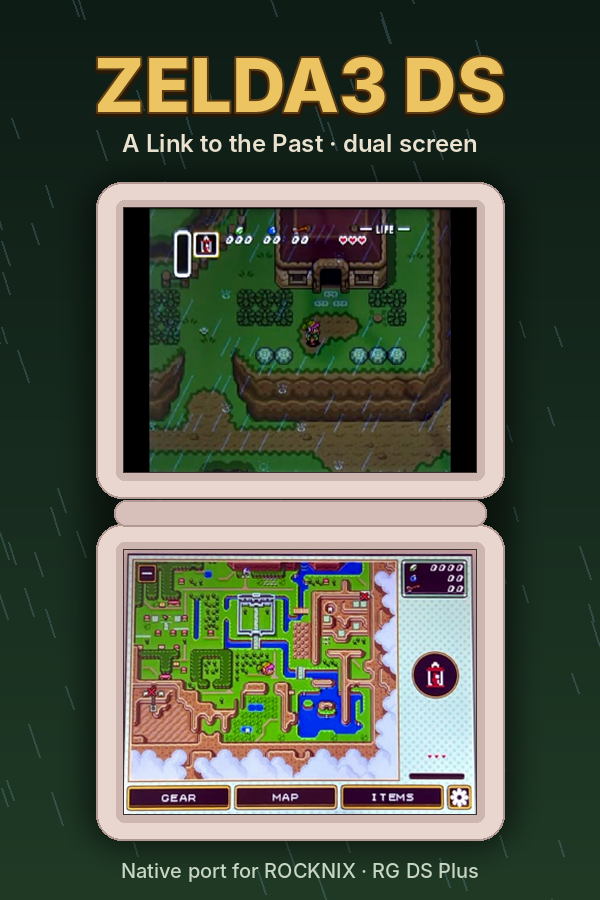
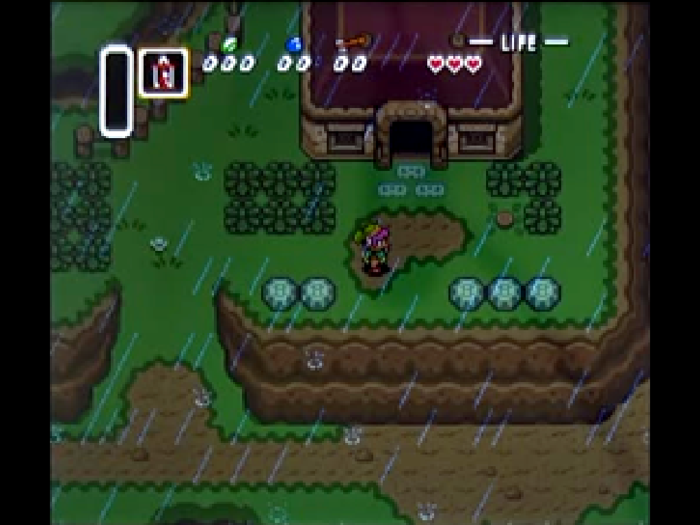
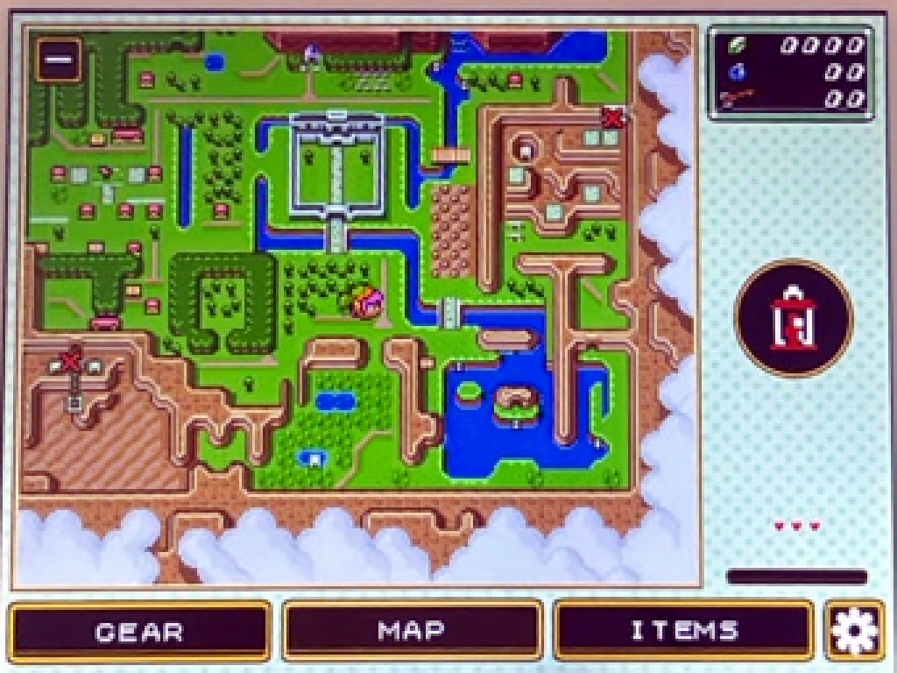

<div align="center">



# Zelda3 DS

**A native dual-screen port of *The Legend of Zelda: A Link to the Past* for ROCKNIX on the Anbernic RG DS Plus**

[](https://rocknix.org/)
[](docs/ROCKNIX-RGDSPLUS.md#hardware)
[](#toolchain)
[](https://www.libsdl.org/)
[](docs/ROCKNIX-RGDSPLUS.md#measured-performance)

[Features](#features) ·
[Screenshots](#screenshots) ·
[Getting started](#getting-started) ·
[Controls](#controls-and-settings) ·
[Technical notes](docs/ROCKNIX-RGDSPLUS.md) ·
[Roadmap](#roadmap)

</div>

---

Zelda3 DS brings [snesrev/zelda3](https://github.com/snesrev/zelda3), the C reimplementation of
*A Link to the Past*, to **ROCKNIX** on the **Anbernic RG DS Plus**, making full use of both
displays:

| Screen | Content |
|:--|:--|
| **Top** | The game, with selectable aspect modes and optional CRT filter |
| **Bottom (touch)** | World map, dungeon map, touch inventory and settings |

The dual-screen interface is based on the `dual-screen` branch of
[zelda3-android](https://github.com/samyost1/zelda3-android), which already ships an SDL2 frontend
for Linux. This repository adds the build tooling, device-specific patches and ROCKNIX integration.

> [!IMPORTANT]
> This project **does not include or distribute any Nintendo content**. You need your own legally
> obtained copy of the game (US ROM) to generate the asset file. See [`rom/README.md`](rom/README.md).

## Features

- 🎮 **Native aarch64 binary** — runs at a locked 60 fps (~8.5 ms per frame) on the stock CPU governor.
- 🖥️ **True dual-screen layout** — the bottom window is placed automatically by ROCKNIX's sway rules; no compositor changes required.
- 🗺️ **Live maps** — world and dungeon maps with the same objective markers the in-game map shows at each point of the story.
- 👆 **Touch inventory** — equip items and assign the X item directly from the bottom screen.
- 📐 **Four aspect modes** for the top screen: `ORIGINAL`, `STRETCH`, `WIDE` (extra columns rendered by the engine, no distortion) and `PIXEL` (integer scaling).
- ⚡ **GPU-accelerated bottom screen** when `OutputMethod = SDL`.
- 💤 **Suspend-aware** — integrates with ROCKNIX sleep via logind: audio pauses and state is saved before the device suspends.
- 🌍 **Multiple languages** — English and a complete Spanish translation (dialogue, pause menu, file select and bottom screen), switchable in-game from the settings. New languages are a folder in [`lang/`](lang/README.md).
- 📦 **PortMaster-style package** — drop it into `/storage/roms/ports/` and it appears in EmulationStation.

## Screenshots

<table>
  <tr>
    <th>Top screen</th>
    <th>Bottom screen</th>
  </tr>
  <tr>
    <td></td>
    <td></td>
  </tr>
</table>

<sub>Reconstructed from a photo of the device with <code>tools/make_art.py</code> (perspective correction and
pixel-grid rebuild). They show the first version of the UI.</sub>

## Getting started

### Requirements

| | Requirement |
|:--|:--|
| **Host (Windows)** | [Docker Desktop](https://www.docker.com/products/docker-desktop/) with the WSL2 backend, and [Git for Windows](https://git-scm.com/download/win) |
| **Host (Linux / macOS)** | Docker and GNU Make |
| **Game data** | Your US ROM at `rom/zelda3.sfc` — see [`rom/README.md`](rom/README.md) |
| **Device** | Up-to-date ROCKNIX with SSH enabled (*Network Settings → Enable SSH*) |

### Build and deploy (Windows / PowerShell)

Run from the repository root:

```powershell
.\build.ps1 image                 # once: build the toolchain image
.\build.ps1 all                   # fetch sources, compile and package
.\build.ps1 assets                # generate zelda3_assets.dat (+ translations in lang\) from rom\zelda3.sfc
.\build.ps1 package               # repackage with the assets included
.\build.ps1 deploy -DeviceIp 192.168.1.50 -DevicePass <ROCKNIX root password>
```

### Build and deploy (Linux / WSL)

```bash
make -f zelda3ds.mk image all assets package deploy DEVICE_IP=192.168.1.50
```

> [!TIP]
> Rename `zelda3ds.mk` to `Makefile` to call `make <target>` directly.

### Manual install

Without SSH, copy the contents of `dist/ports/` into the `ports` folder on the SD card (or the
ROCKNIX Samba share) and refresh the game list in EmulationStation.

## Controls and settings

| Action | Input |
|:--|:--|
| **Exit** | <kbd>L1</kbd> + <kbd>Start</kbd> + <kbd>Select</kbd>, or *QUIT GAME* in settings (double tap) |
| **Bottom screen tabs** | `GEAR`, `MAP`, `ITEMS` — the cog icon opens the settings |

<details>
<summary><b>Settings menu</b></summary>

| Option | Description |
|:--|:--|
| `TOP SCREEN` | Aspect mode: `ORIGINAL`, `STRETCH`, `WIDE` or `PIXEL` (see `TopScreenAspect` in [`zelda3.ini`](port/zelda3/zelda3.ini)) |
| `TOP SCREEN HUD` | Show or hide the HUD on the top screen |
| `CRT FILTER` | Toggle the CRT filter |
| `AUTOSAVE ON EXIT` | Save state on exit and restore it on launch |
| `LANGUAGE` | Cycle through the languages in `zelda3_assets.dat` (`Language` in `zelda3.ini`) |
| `SAVE STATE` / `LOAD STATE` | Slot 1 |
| `REMAP BUTTONS` | Reassign the gamepad buttons |
| `QUIT GAME` | Exit to EmulationStation |

</details>

**Map** — always shows the same objectives as the in-game map for the current point of the story.

**Suspend** — pressing the power button or closing the lid stops the audio and, if
*AUTOSAVE ON EXIT* is enabled, saves the state before ROCKNIX suspends. If the battery runs out
while the device is asleep, the game resumes from that point on the next launch.

## Toolchain

| Component | Choice |
|:--|:--|
| Build | **aarch64** cross-compilation in Docker (Debian bookworm, glibc 2.36, SDL2 2.26) |
| Target CPU | `-march=armv8.2-a -mtune=cortex-a55` (RK3568) |
| Distribution format | **PortMaster**-style port in `/storage/roms/ports/` |
| Dual screen | ROCKNIX sway rule matching the window title (`… Bottom …`) |
| Assets | snesrev's `restool.py` run on the host with your ROM (never distributed) |

The rationale behind each choice is documented in [`docs/ROCKNIX-RGDSPLUS.md`](docs/ROCKNIX-RGDSPLUS.md).

## Project structure

```text
.
├── config/versions.env     Pinned upstream commits and target flags
├── docker/Dockerfile       aarch64 cross toolchain + arm64 SDL2 + Python (Pillow, PyYAML)
├── scripts/                fetch-sources, build, extract-assets, package, deploy
├── patches/                Port changes on top of zelda3-android (git format-patch)
├── port/                   Zelda3.sh launcher, zelda3.ini for RG DS Plus, port.json, gameinfo.xml
├── lang/                   Translations: dialogue, font glyphs and interface texts per language
├── rom/                    Your ROM (git-ignored)
├── docs/                   ROCKNIX / RG DS Plus technical notes and screenshots
├── tools/                  make_art.py (screenshots/cover art), lang/build_assets.py (translations)
├── build.ps1               Windows entry point (no make required)
└── zelda3ds.mk             Make entry point for Linux / WSL

external/  build/  dist/    Generated output (git-ignored)
```

## Roadmap

- [x] Toolchain, pinned sources, packaging and deployment
- [x] First boot on the device (2026-10-15)
- [x] Exit combo, settings menu, aspect modes and map markers synced with the game
- [x] Touch input verified on the device; more legible bottom UI
- [x] `OutputMethod = SDL` by default; GPU-rendered bottom screen; performance logging to `log.txt`
- [x] Performance measured on the device: locked 60 fps, ~8.5 ms per frame on the default governor
- [x] ROCKNIX suspend integration (logind)
- [x] Cover art and screenshots (`cover.png`, `screenshot.png`)
- [x] Multi-language support and Spanish translation (`lang/`, patch `0007`)
- [ ] Screenshots of the current UI (pending an on-device capture method)

## Acknowledgements

- [**snesrev/zelda3**](https://github.com/snesrev/zelda3) — the reimplementation this port is built on.
- [**samyost1/zelda3-android**](https://github.com/samyost1/zelda3-android) — the dual-screen interface and its Linux SDL2 frontend.
- [**ROCKNIX**](https://rocknix.org/) and [**RocknixDS**](https://github.com/JorreFog/ROCKNIXDS) — the operating system and its dual-screen support.
- [**PortMaster**](https://portmaster.games/) — port packaging conventions and controller mapping.

## License

The zelda3 and zelda3-android source code is released under the MIT License. *The Legend of Zelda*
and *A Link to the Past* are trademarks of Nintendo. This project is not affiliated with or endorsed
by Nintendo and contains no copyrighted game data.
